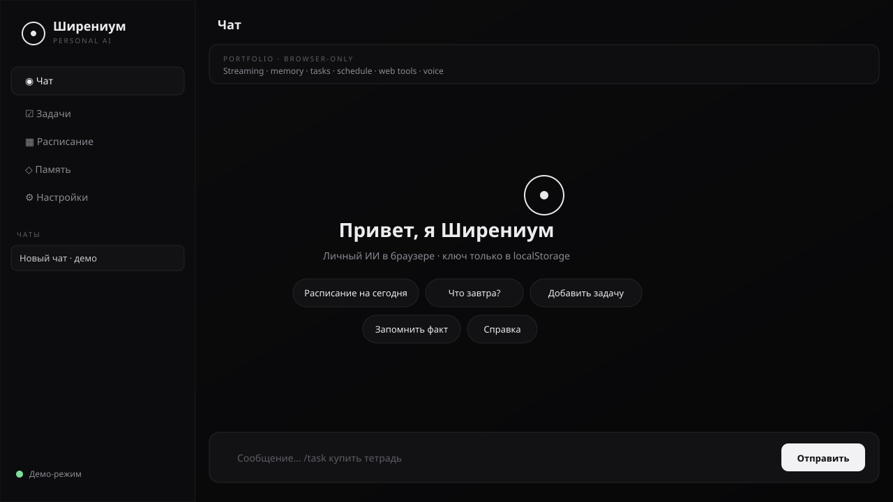

# Shira — Personal AI Assistant

A serious, browser-based personal AI for a portfolio: streaming chat, agent tool-loop (web / wiki / calc / reminders), multi-session memory, tasks, configurable TulSU schedule, file attachments, voice, and a **demo mode with no API key**.

**Live:** [shirenos.github.io/personal-ai](https://shirenos.github.io/personal-ai/)


<p align="center">
  
</p>

## Why this exists

Most “AI wrappers” are demos or SaaS. Shira is a **local-first shell**: polished graphite UI, real `localStorage` persistence, university schedule, and a system prompt that injects profile, memories, open tasks, and the next days of classes — plus an agent loop that can call web search and Wikipedia entirely in the browser.

## Features

| Area | What works |
|------|------------|
| **Chat** | Streaming OpenAI-compatible completions, Markdown, stop / regenerate, latency chips |
| **Agent tools** | Fenced `tools` + `actions` blocks → web search, Wikipedia, calculator, reminders, add/complete task, remember |
| **Demo mode** | Works without a key (slash commands + schedule + templated replies) |
| **Sessions** | Multiple chats in `localStorage`; new / switch / delete |
| **Memory** | Profile + notes; export/import JSON; injected into the system prompt |
| **Tasks** | Panel + `/task …`; assistant can mutate via `actions` |
| **Schedule** | TulSU cache; **configurable group id** (default `221461`); `/schedule` `/tomorrow` |
| **Attachments** | txt / md / pdf / images (pdf.js CDN) |
| **Voice** | Web Speech when available; graceful message on Safari/Firefox without it |
| **Onboarding** | First-run modal: where to get a Groq key, localStorage disclosure, demo CTA |
| **Security UX** | Clear key + **wipe all data**; key sent **only** to configured Base URL (no app server) |
| **i18n** | RU/EN UI. Document title & OG meta stay **English on purpose** for GitHub SEO |

### Recommended free setup

1. Create a key at [console.groq.com/keys](https://console.groq.com/keys)
2. Settings → preset **Smart** (`openai/gpt-oss-120b`) or **Fast** (`openai/gpt-oss-20b`)
3. Paste key → Save → chat  
   Older Llama free-tier IDs auto-migrate after Groq’s 2026-08-16 retirement.

Also works with **OpenRouter**, **OpenAI**, or any OpenAI-compatible local server.

> **Privacy:** the API key lives only in this browser’s `localStorage`. It is never committed to the repo and is never sent to GitHub Pages — only to the Base URL you configure (e.g. `https://api.groq.com/openai/v1`).

## Architecture

```
index.html
css/styles.css
js/
  app.js           panels, onboarding, sessions UI, attachments
  chat.js          system prompt, streaming, agent tool loop
  tools-exec.js    web_search / wiki / calculate / reminder
  sessions.js      multi-chat persistence
  files.js         txt/md/pdf/image → prompt text
  demo.js          no-key replies
  memory.js tasks.js schedule.js settings.js voice.js i18n.js markdown.js storage.js
data/schedule.json cached TulSU timetable (default group 221461)
```

## Schedule

TulSU JSON is usually blocked in the browser (CORS). The app ships `data/schedule.json` and a GitHub Action refreshes it. In Settings you can change the **group id** (default `221461`); live Refresh uses that group when CORS allows.

```bash
node scripts/update-schedule.mjs
```

## Local run

```bash
python3 -m http.server 8080 --directory .
# http://127.0.0.1:8080
```

No build step. ES modules only.

## Slash commands

`/task` · `/remember` · `/schedule` · `/tomorrow` · `/clear` · `/help` · `/demo`

## License

MIT
